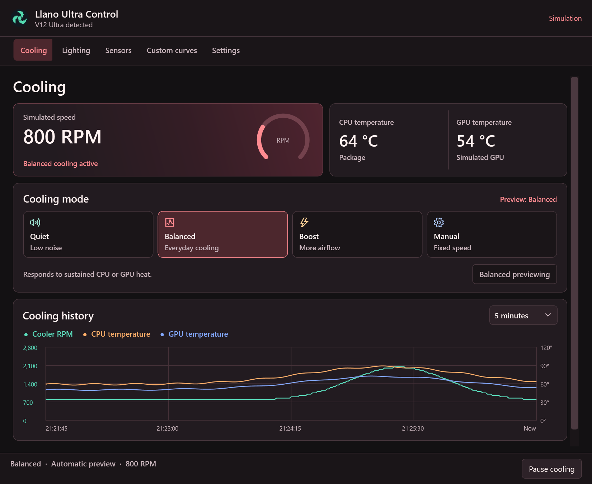

# Llano Ultra Control

Control the **Llano V12 Ultra cooling pad** from Windows 11 x64. Choose automatic or manual fan control, build temperature curves, and adjust lighting and power over USB.

## Download 1.0.2

| Download | When to choose it |
| --- | --- |
| **[Portable ZIP](https://github.com/jsculli0n/llano-ultra-control/releases/download/v1.0.2/LlanoUltraControl-1.0.2-win-x64-portable.zip)** | Recommended. Extract the ZIP and run `LlanoUltraControl.exe`. Keep the extracted files together. |
| [Windows MSI](https://github.com/jsculli0n/llano-ultra-control/releases/download/v1.0.2/LlanoUltraControl-1.0.2-win-x64.msi) | Adds a Start menu shortcut, with options for a desktop shortcut and opening the app after setup. |
| [Release notes and checksums](https://github.com/jsculli0n/llano-ultra-control/releases/latest) | See what’s included and verify your download. |

## Get started

1. Connect the cooler’s power adapter and USB data cable, then turn the cooler on.
2. Open the app and choose **Quiet**, **Balanced**, **Boost**, or **Manual** on the Cooling tab.
3. Select **Apply**. Moving the physical dial returns speed control to the cooler.

**Verified hardware:** V12 Ultra revision `1601`, USB ID `374A:B101`. Automatic cooling needs a readable CPU or GPU temperature. USB fan, lighting, and power control can work without those readings.

## Help and source code

- [User guide](docs/user-guide.md) · Setup, controls, USB troubleshooting, and download verification
- [Build from source](docs/build.md) · Build commands and hardware checks
- [Report an issue](https://github.com/jsculli0n/llano-ultra-control/issues/new) · Include the app version, cooler revision, and steps to reproduce

Independent project, unaffiliated with llano. It controls the external cooling pad. Your laptop manages its own fans and thermal protection.

[MIT licence](LICENSE) · [Third-party notices](THIRD-PARTY-NOTICES.md)
