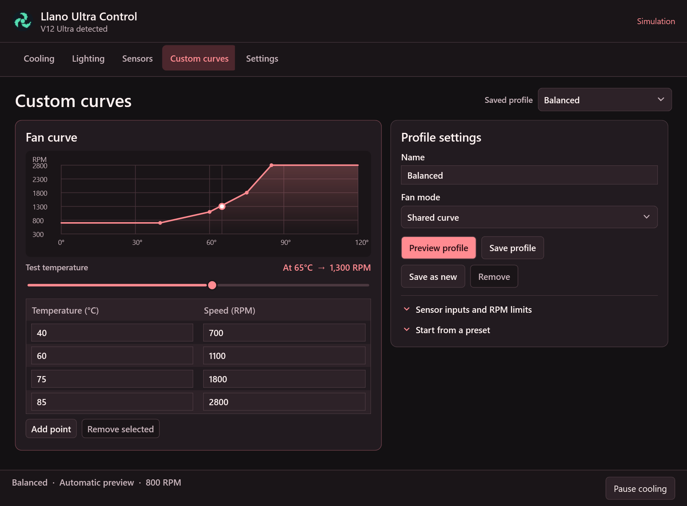
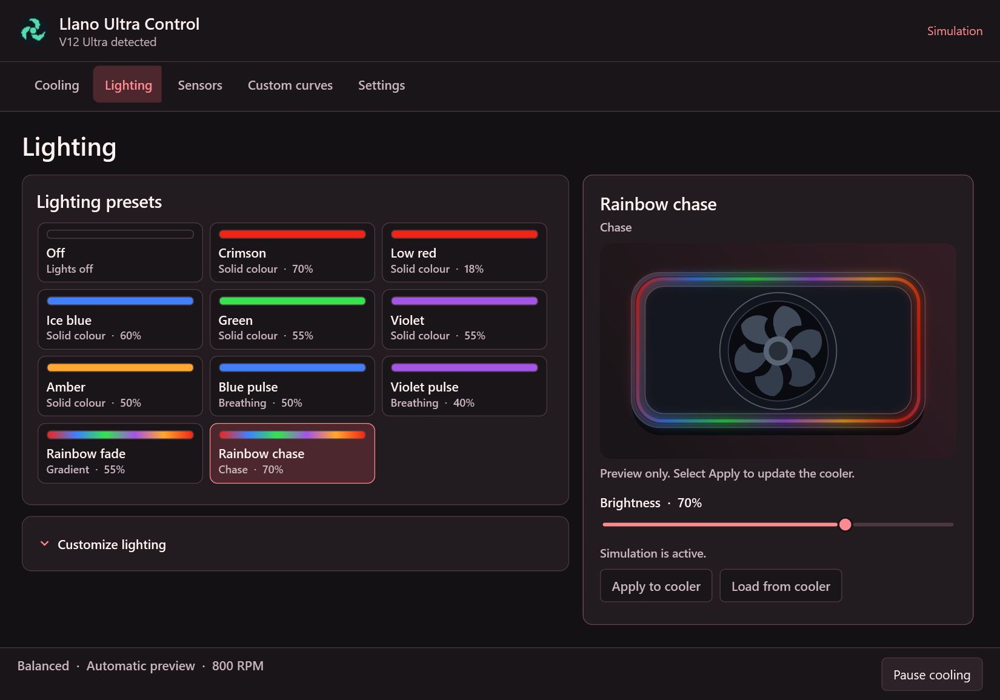

# Llano Ultra Control

An open-source Windows 11 x64 app for the **Llano V12 Ultra** laptop cooling pad. Control the external fan and RGB lighting over USB, see how cooling responds to CPU and GPU temperatures, and keep an eye on performance with a compact desktop overlay.

**[Download the Windows MSI](https://github.com/jsculli0n/llano-ultra-control/releases/download/v1.0.6/LlanoUltraControl-1.0.6-win-x64.msi)** · **[Download the portable ZIP](https://github.com/jsculli0n/llano-ultra-control/releases/download/v1.0.6/LlanoUltraControl-1.0.6-win-x64-portable.zip)** · [Release notes and checksums](https://github.com/jsculli0n/llano-ultra-control/releases/latest)

## Features

| Feature | What you can do |
| --- | --- |
| **Fan control** | Choose Quiet, Balanced, Boost, or a fixed manual speed. Quiet starts at 300 RPM under light load. Moving the cooler’s dial pauses software control. |
| **Custom curves** | Start from a preset and tune the RPM at each temperature. Use a shared curve or separate CPU and GPU curves, and test them before applying. |
| **Cooling history** | Compare cooler RPM with CPU and GPU temperatures over a selectable window from 60 seconds to 24 hours. |
| **Sensors and desktop overlay** | View available component readings and choose which stats stay visible on the desktop, including CPU and GPU load, temperature and clock, memory usage, FPS and cooler RPM. Adjust position, size, opacity and theme colours. |
| **RGB lighting** | Preview effects, customise colours and brightness, and save your own lighting presets. |
| **Power and startup** | Launch in the notification area at sign-in, optionally resume cooling, and turn the pad off at Windows shutdown and back on at sign-in. |

Custom curves and RGB lighting screenshots

## Get started

1. Install the MSI or extract the portable ZIP and run `LlanoUltraControl.exe`. The MSI adds Start menu and optional desktop shortcuts.
2. Connect the cooler’s power adapter and USB data cable, then turn the cooler on.
3. Open **Cooling**, choose a mode, and select **Apply**.

The MSI supports optional one-time telemetry helper setup in **Settings → General** for supported CPU sensors and foreground-app FPS. Temperature availability depends on your hardware and sensor drivers. Automatic presets require a readable CPU temperature. Manual speed, lighting, and power are available over USB.

**Verified cooler:** V12 Ultra revision `1601` (USB ID `374A:B101`). The screenshots use sample readings in simulation. Llano Ultra Control is an independent project. It controls the external cooling pad while Windows and your laptop manage the internal fans and thermal protection.

## Help and source code

- [User guide](docs/user-guide.md) for setup, controls, USB troubleshooting and download verification
- [Build from source](docs/build.md) for build commands and hardware checks
- [Report an issue](https://github.com/jsculli0n/llano-ultra-control/issues/new) with your app version, cooler revision and steps to reproduce

[MIT licence](LICENSE) · [Third-party notices](THIRD-PARTY-NOTICES.md)
